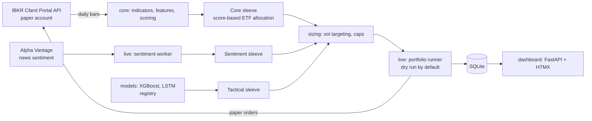

# Trading bot

[](https://github.com/pechkornel/trading-bot/actions/workflows/ci.yml)

A self-hosted, **paper-trading-only** portfolio bot for Interactive Brokers, built in Python.
It started as four separate experiments (an XGBoost trend classifier, an LSTM model, a test
bot and a backtester) and was consolidated into one codebase with a model registry, a
multi-sleeve portfolio, a sentiment feed, a web dashboard and a Docker deployment.

> This is a personal learning project. It only ever trades a paper (simulated) account and
> refuses to start otherwise. Nothing here is investment advice.

## What it does

The portfolio is split into independent **sleeves**, each with its own budget, strategy and
positions:

| Sleeve | Share | Strategy |
|---|---:|---|
| **Core** | 70% | Weekly score-based allocation across 10 ETFs (equity, bonds, gold, commodities, cash). Score = 40% momentum + 30% macro alignment + 30% trend; holds the top 4 equally weighted, with a hard risk-off switch to bonds when SPY is below its 200-day average and VIX is above 25. |
| **Sentiment** | 20% | News-driven satellite on the Alpha Vantage News & Sentiment API: goes long only on strong bullish spikes (score above 0.4 with at least 5 articles), with a 10-day exit or a 5% stop. |
| **Tactical** | off | The original 5-minute XGBoost / LSTM trend models with volatility-targeted sizing. The code is kept and can be switched back on in `config/symbols.yaml`. |

The trading rules are written up in plain language in [docs/TRADING_LOGIC.md](docs/TRADING_LOGIC.md),
and every library choice is explained in [docs/TECH_STACK.md](docs/TECH_STACK.md).

## Machine learning part

- **Features** (`core/indicators.py`, `core/features.py`): ADX, ATR, Bollinger Bands, EMA, MA,
  MACD, OBV, RSI, linear regression channel and recent lows, grouped into named feature sets.
- **Labels** (`models/train.py`): the future price change over `n` bars, turned into a binary
  (up / not up) or three-class (up / sideways / down) target with a threshold.
- **Models:** XGBoost with class weights or SMOTE, and a 2-layer LSTM, both trained by
  `train_xgboost()` / `train_lstm()` and saved with their metadata by `models/registry.py`, so
  the live runner always knows which features and scaler a model expects.
- **Signal fusion** (`core/signal_fusion.py`): in the tactical sleeve the model's confidence is
  combined with news sentiment (70% / 30%). Sentiment can strengthen or weaken a signal but never
  flips its direction, and it is ignored when it is stale.
- **Position sizing** (`core/sizing.py`): volatility targeting from realised volatility, with
  per-symbol and gross exposure caps per sleeve.

## Architecture



```
core/        indicators, features, scoring, sizing, signal fusion, sleeves, config, broker client
models/      training (XGBoost, LSTM) and the artifact registry
live/        portfolio runner, sentiment worker, SQLite storage, notifications
dashboard/   FastAPI + HTMX web UI: status, sleeves, targets, orders, models, logs, start/stop
deploy/      Ubuntu setup, systemd units, backups
docker/      Dockerfile; docker-compose.yml runs dashboard, portfolio runner and sentiment worker
```

## Safety

- Hard **paper-only lock**: `PAPER=true` and a paper gateway port are required, checked in
  `core.config.assert_paper_mode()` before any broker connection is opened.
- **Dry run by default**: decisions are logged, orders are only sent with `--live`.
- The automated broker login is **not included** in this public version (`core/ibkr_auth.py` is
  a stub). See [SECURITY.md](SECURITY.md).

## Run it

```sh
python -m venv .venv && source .venv/bin/activate
pip install -r requirements.txt            # add requirements-train.txt to train models
cp .env.example .env                       # fill in your own values

python -m live.portfolio_runner --once     # one dry-run cycle of every enabled sleeve
uvicorn dashboard.app:app --port 8765      # dashboard
docker compose --profile auto up -d        # or everything in Docker
```

## Stack

Python, pandas, NumPy, scikit-learn, XGBoost, TensorFlow/Keras (LSTM), FastAPI, HTMX, SQLite,
Docker, systemd, Interactive Brokers Client Portal API, Alpha Vantage
