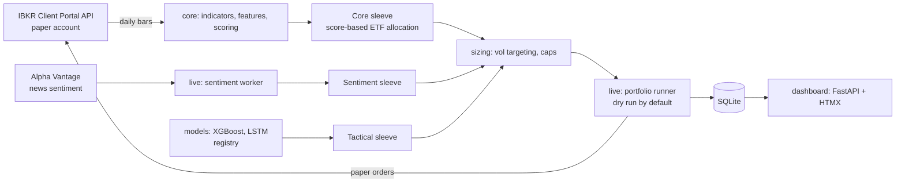
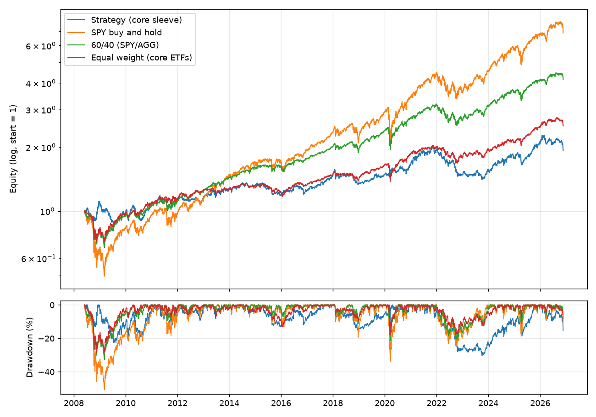

# Trading bot

[](https://github.com/pechkornel/trading-bot/actions/workflows/ci.yml)

A self-hosted, **paper-trading-only** portfolio bot for Interactive Brokers, built in Python.
It started as four separate experiments (an XGBoost trend classifier, an LSTM model, a test
bot and a backtester) and was consolidated into one codebase with a model registry, a
multi-sleeve portfolio, a sentiment feed, a web dashboard and a Docker deployment.

> This is a personal learning project. It only ever trades a paper (simulated) account and
> refuses to start otherwise. Nothing here is investment advice.

## What it does

The portfolio is split into independent **sleeves**, each with its own budget, strategy and
positions:

| Sleeve | Share | Strategy |
|---|---:|---|
| **Core** | 70% | Weekly score-based allocation across 10 ETFs (equity, bonds, gold, commodities, cash). Score = 40% momentum + 30% macro alignment + 30% trend; holds the top 4 equally weighted, with a hard risk-off switch to bonds when SPY is below its 200-day average and VIX is above 25. |
| **Sentiment** | 20% | News-driven satellite on the Alpha Vantage News & Sentiment API: goes long only on strong bullish spikes (score above 0.4 with at least 5 articles), with a 10-day exit or a 5% stop. |
| **Tactical** | off | The original 5-minute XGBoost / LSTM trend models with volatility-targeted sizing. The code is kept and can be switched back on in `config/symbols.yaml`. |

The trading rules are written up in plain language in [docs/TRADING_LOGIC.md](docs/TRADING_LOGIC.md),
and every library choice is explained in [docs/TECH_STACK.md](docs/TECH_STACK.md).

## Machine learning part

- **Features** (`core/indicators.py`, `core/features.py`): ADX, ATR, Bollinger Bands, EMA, MA,
  MACD, OBV, RSI, linear regression channel and recent lows, grouped into named feature sets.
- **Labels** (`models/train.py`): the future price change over `n` bars, turned into a binary
  (up / not up) or three-class (up / sideways / down) target with a threshold.
- **Models:** XGBoost with class weights or SMOTE, and a 2-layer LSTM, both trained by
  `train_xgboost()` / `train_lstm()` and saved with their metadata by `models/registry.py`, so
  the live runner always knows which features and scaler a model expects.
- **Signal fusion** (`core/signal_fusion.py`): in the tactical sleeve the model's confidence is
  combined with news sentiment (70% / 30%). Sentiment can strengthen or weaken a signal but never
  flips its direction, and it is ignored when it is stale.
- **Position sizing** (`core/sizing.py`): volatility targeting from realised volatility, with
  per-symbol and gross exposure caps per sleeve.

## Architecture



```
core/        indicators, features, scoring, sizing, signal fusion, sleeves, config, broker client
models/      training (XGBoost, LSTM) and the artifact registry
live/        portfolio runner, sentiment worker, SQLite storage, notifications
dashboard/   FastAPI + HTMX web UI: status, sleeves, targets, orders, models, logs, start/stop
deploy/      Ubuntu setup, systemd units, backups
docker/      Dockerfile and the optional gateway image; docker-compose.yml runs dashboard, portfolio runner and sentiment worker
```

## Safety

- Hard **paper-only lock**: `PAPER=true` and a paper gateway port are required, checked in
  `core.config.assert_paper_mode()` before any broker connection is opened.
- **Dry run by default**: decisions are logged, orders are only sent with `--live`.
- The automated broker login is **not included** in this public version (`core/ibkr_auth.py` is
  a stub). You can add your own as `core/ibkr_auth_private.py`, which is git-ignored and must
  never be committed. See [SECURITY.md](SECURITY.md).
- The dashboard has no authentication, so it binds to `127.0.0.1` by default. Use
  `tailscale serve` for tailnet access, never Funnel.

## Results

`backtest/` replays the live **core sleeve** day by day by calling the bot's own sleeve and
macro code (see [ADR 0002](docs/adr/0002-own-backtest-replay.md)). Period 2008-05-29 to
2026-11-20, 5 bps cost per unit of turnover, parameters exactly as in `config/symbols.yaml`.

| Portfolio | CAGR | Volatility | Sharpe | Max drawdown |
|---|---:|---:|---:|---:|
| Core sleeve (strategy) | 3.62% | 11.93% | 0.25 | -30.48% |
| SPY buy and hold | 11.02% | 19.72% | 0.56 | -50.70% |
| 60/40 (SPY/AGG) | 8.03% | 11.88% | 0.60 | -32.79% |
| Equal weight (10 core ETFs) | 5.12% | 9.66% | 0.43 | -28.41% |



**Over the full period, the core sleeve had a lower CAGR and Sharpe than SPY and 60/40
for every rebalance weekday.** (It did beat SPY in 2008 to 2012; see the subperiod table.) Against equal weight it is behind with a Friday (live) or Monday rebalance, about level on
Tuesday and Wednesday (slightly ahead on CAGR) and a little behind on Thursday. The Sharpe
difference for the live Friday rebalance is not statistically significant (see the weekday
and bootstrap tables in [docs/backtest/results.md](docs/backtest/results.md)). Its
drawdown was smaller than SPY and 60/40 but not smaller than equal weight. In the ablations, disabling the risk-off switch improved it
(CAGR 4.86%, Sharpe 0.36, max drawdown -17.66%), and so did dropping the macro score or
using momentum only. No variant beat 60/40 or SPY. Full tables, calendar-year returns and the
list of deviations from live are in [docs/backtest/results.md](docs/backtest/results.md).

Limitations:

- Core sleeve only. The sentiment satellite and the tactical sleeve are not tested.
- The universe is today's ETF list, picked with hindsight (survivorship). ETF start dates set
  the start of the test.
- Parameters were fixed before the test and not optimised.
- One decision a day at the close, filled at the next close with fractional weights. Live uses
  DAY limit orders on integer shares.
- Live fills on Friday intraday. The backtest decides at Friday's close and fills at the next
  trading day's close (usually Monday). Results depend on the rebalance weekday.
- No significance: the strategy-minus-benchmark Sharpe differences have wide bootstrap
  intervals, so small gaps between portfolios are not evidence.
- Signals use raw `Close` (price return, no dividends), as the live bot does. Bond ETFs are
  understated by their yield.
- Costs are a flat bps rate: no slippage, taxes or fees. Cash earns 0.
- Drift is measured against marked-to-market equity. Live uses a fixed budget.
- Macro inputs are Yahoo and FRED final data, not point-in-time vintages, so revisions are
  not modelled.
- The re-entry cooldown never binds in the replay.
- Turnover is high (about 13x per year, buys plus sells), so the result is cost sensitive: 4.29% CAGR at 0 bps,
  1.61% at 20 bps.

To reproduce (network needed; the first run downloads the price and macro series and caches
them in `data/cache/backtest/`):

```sh
uv pip install -r requirements-backtest.txt
python -m backtest.run               # add --refresh to download everything again
```

## Run it

```sh
# Setup. macOS/Linux shown; on Windows use .venv\Scripts\python and .venv\Scripts\ruff
uv venv --python 3.11
uv pip install -r requirements.txt          # add requirements-train.txt to train models
uv pip install -r requirements-dev.txt      # pytest and ruff
cp .env.example .env                        # fill in your own values

.venv/bin/python -m live.portfolio_runner --once                             # one dry-run cycle of every enabled sleeve
.venv/bin/python -m uvicorn dashboard.app:app --host 127.0.0.1 --port 8765   # dashboard
.venv/bin/python -m backtest.run                                             # core sleeve backtest (needs requirements-backtest.txt)
docker compose --profile auto up -d                                          # or everything in Docker

# Lint and tests (what CI runs)
.venv/bin/ruff format --check .
.venv/bin/ruff check .
.venv/bin/python -m pytest -q
```

Use `python -m uvicorn` so the dashboard runs on the venv interpreter (it starts workers with `sys.executable`).

## Stack

Python, pandas, NumPy, scikit-learn, XGBoost, TensorFlow/Keras (LSTM), FastAPI, HTMX, SQLite,
Docker, systemd, Interactive Brokers Client Portal API, Alpha Vantage
