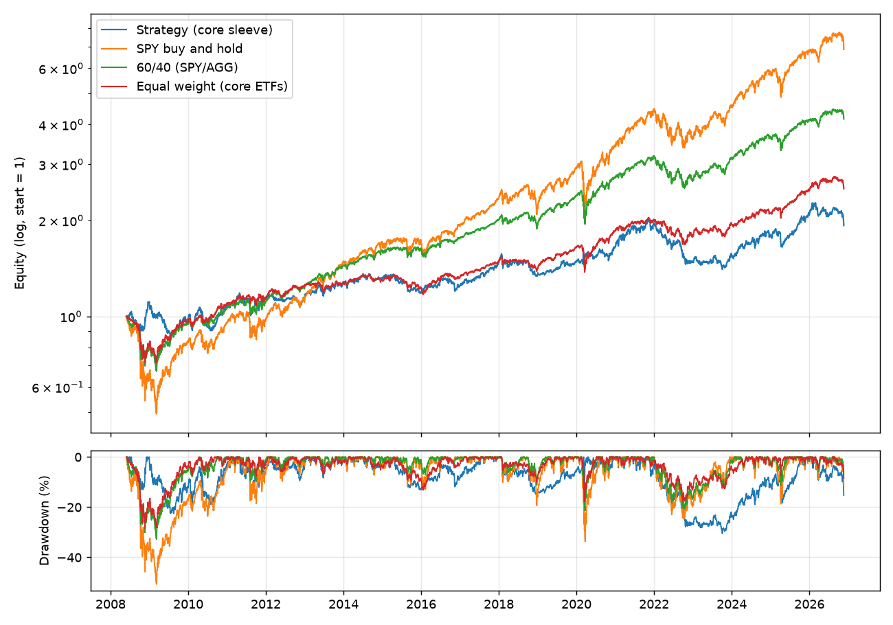

# Core sleeve backtest results

## Summary

- Generated: 2026-11-24 01:57 UTC
- Data downloaded: 2026-11-24T01:39:49Z
- yfinance version: 1.8.0
- Start date: 2008-05-29
- End date: 2026-11-20
- Trading days: 4651
- Days dropped from the calendar (a core ETF had no price): 0
- Bars required before the start: 253
- Base cost: 5 bps per unit of turnover

## Data sources

Daily bars from Yahoo Finance through yfinance (`Close` and `Adj Close`, `auto_adjust=False`). T10Y2Y from FRED through the bot's own parser.

| Series | First date | Last date | Rows |
|---|---|---|---|
| AGG | 2003-09-29 | 2026-11-20 | 5825 |
| BIL | 2007-05-30 | 2026-11-20 | 4903 |
| DBC | 2006-02-06 | 2026-11-20 | 5232 |
| DX-Y.NYB | 1971-01-04 | 2026-11-23 | 14192 |
| EFA | 2001-08-27 | 2026-11-20 | 6347 |
| GLD | 2004-11-18 | 2026-11-20 | 5537 |
| HYG | 2007-04-11 | 2026-11-20 | 4937 |
| IEF | 2002-07-30 | 2026-11-20 | 6119 |
| IWM | 2000-05-26 | 2026-11-20 | 6662 |
| LQD | 2002-07-30 | 2026-11-20 | 6119 |
| SPY | 1993-01-29 | 2026-11-20 | 8512 |
| TLT | 2002-07-30 | 2026-11-20 | 6119 |
| VWO | 2005-03-10 | 2026-11-20 | 5461 |
| ^VIX | 1990-01-02 | 2026-11-23 | 9294 |
| FRED T10Y2Y | 1976-06-01 | 2026-11-23 | 12616 |

## Assumptions and deviations from live

- Signals use Yahoo split-adjusted `Close`. P&L uses `Adj Close` (dividends reinvested). Adjusted closes are never passed to the sleeve, the scoring code or the macro fetcher.
- Timing: each trading day is evaluated once at 21:00 UTC (the 16:00 New York close). A decision made at the close of day t is filled at the close of the next trading day. The strategy starts in cash and waits for the first decision on the rebalance weekday (Friday in the live config). A Friday decision is therefore filled at the next trading day's close, usually Monday. See the weekday sensitivity table.
- Costs: `cost_bps / 10000 * turnover` of equity on the fill day, where turnover is the sum of absolute weight changes over assets (cash excluded), so it is two-way (buys plus sells). A first buy from cash is 1.0, a full switch is 2.0. The first entry is charged for every portfolio.
- Cash earns 0. Weight not invested earns nothing.
- Momentum, trend and the HYG/LQD credit ratio use raw `Close` (price return, no dividends), exactly as the live bot does. Bond ETFs and BIL are understated by their yield, and distribution days (for example DBC each December) look like price drops for 12 months. This is a property of the live bot's signals, not of the backtest.
- Holdings given to the sleeve are synthetic fractional shares on a constant notional, so the drift rule sees true current weights. Live uses integer shares and DAY limit orders at plus or minus 5 bps; the backtest fills fractional weights at the next close.
- Sleeve equity is marked to market. Live measures drift against a fixed starting-equity budget (the known gap 'Static starting equity' in `docs/TRADING_LOGIC.md` section 8).
- The re-entry cooldown is called with live semantics, but with one decision per day at a fixed clock the next decision is exactly 86400 s later, which counts as free. It never binds in the replay.
- Macro: the bot's own `MacroFetcher.snapshot()` runs on cached series sliced as of the decision date. FRED T10Y2Y uses observations dated strictly before the decision day (a one day lag). VIX, DXY, HYG and LQD use raw closes up to and including the decision day.
- VIX settles at 16:15 ET and DXY at 17:00 ET, slightly after the 16:00 equity close. The effect on a 60-day trend and a level test against 25 is tiny.
- Fed funds (DFF) is not downloaded, so the macro snapshot is never `complete`. This has no effect on scores because the neutral guard also needs VIX and the curve to be missing.
- HYG and LQD are downloaded because the live macro score uses the credit ratio trend for equity and bond buckets.
- Benchmarks: SPY buy and hold; 60% SPY and 40% AGG; equal weight over the core universe (BIL included). The two rebalanced benchmarks decide on the last trading day of each month and fill on the first trading day of the next month, at the same cost rate as the strategy run they are compared with.
- The risk-free rate for Sharpe and Sortino is the BIL daily adjusted close return. It includes BIL's expense ratio (about 0.135%), which slightly flatters every Sharpe.
- CAGR uses 252 trading days per year: `(end / start) ** (252 / n_returns) - 1`.
- Risk-off share: share of trading days positioned on a risk-off decision, from the fill day of that decision to the next fill.
- Start date: first trading day on which every required ticker has enough raw closes for the longest signal window, and T10Y2Y has an observation before it.
- Trading days are dates on which all core ETFs have a raw and an adjusted close. Macro tickers are joined as of the last value on or before the decision day.

Known gaps between this backtest and live trading:

- Live evaluates on the first open cycle on Friday using intraday data and fills the same day with DAY limit orders. The backtest decides at Friday's close and fills at the next trading day's close (usually Monday). The weekday sensitivity table shows how much the choice of weekday matters.
- Live fills are DAY limit orders at plus or minus 5 bps on integer shares and may be partial or missed. The backtest fills fractional weights at the next close.
- Live decides when the runner wakes up on its schedule, not at a fixed close.
- Live uses a fixed sleeve budget for drift; the backtest marks it to market.
- Live cash may earn a money market rate; backtest cash earns 0.
- Live Yahoo and CPGW data can be revised or delayed; the backtest uses one final download. Survivorship is not modelled: the universe is today's ETF list.
- Taxes, fees other than the flat cost rate, and market impact are not modelled.

## Headline results

Strategy and benchmarks, base cost 5 bps. Turnover is two-way (buys plus sells): a full switch counts as 200%.

| Portfolio | CAGR | Volatility | Sharpe | Sortino | Max drawdown | Peak | Trough | Recovery | Calmar | Turnover per year (buys plus sells) | Risk-off share |
|---|---|---|---|---|---|---|---|---|---|---|---|
| Strategy (core sleeve) | 3.62% | 11.93% | 0.25 | 0.34 | -30.48% | 2021-11-08 | 2023-10-04 | 2025-10-08 | 0.12 | 1303% | 12.8% |
| SPY buy and hold | 11.02% | 19.72% | 0.56 | 0.79 | -50.70% | 2008-06-05 | 2009-03-09 | 2011-02-08 | 0.22 | 5% | n/a |
| 60/40 (SPY/AGG) | 8.03% | 11.88% | 0.60 | 0.84 | -32.79% | 2008-06-05 | 2009-03-09 | 2010-04-14 | 0.24 | 27% | n/a |
| Equal weight (core ETFs) | 5.12% | 9.66% | 0.43 | 0.60 | -28.41% | 2008-06-05 | 2008-11-20 | 2010-04-14 | 0.18 | 40% | n/a |

## Rebalance weekday sensitivity

Base config at 5 bps, changing only the weekday of the weekly rebalance (0 = Monday to 4 = Friday). The weekday set in the live config is marked. The strategy decides at that day's close and fills at the next trading day's close.

| Weekday | CAGR | Volatility | Sharpe | Max drawdown |
|---|---|---|---|---|
| 0 Mon | 4.17% | 11.95% | 0.29 | -23.99% |
| 1 Tue | 5.71% | 11.90% | 0.42 | -26.91% |
| 2 Wed | 5.81% | 12.04% | 0.42 | -26.22% |
| 3 Thu | 4.81% | 12.03% | 0.34 | -28.09% |
| 4 Fri (live) | 3.62% | 11.93% | 0.25 | -30.48% |

## Subperiods

CAGR and Sharpe over calendar-year ranges, base cost. The first and last ranges can be partial. CAGR uses 252 trading days per year.

| Portfolio | 2008 to 2012 CAGR | 2008 to 2012 Sharpe | 2013 to 2019 CAGR | 2013 to 2019 Sharpe | 2020 to 2026 CAGR | 2020 to 2026 Sharpe |
|---|---|---|---|---|---|---|
| Strategy (core sleeve) | 3.01% | 0.26 | 3.75% | 0.38 | 3.89% | 0.15 |
| SPY buy and hold | 2.60% | 0.22 | 14.61% | 1.08 | 13.29% | 0.59 |
| 60/40 (SPY/AGG) | 4.64% | 0.35 | 9.91% | 1.22 | 8.43% | 0.49 |
| Equal weight (core ETFs) | 4.97% | 0.41 | 4.00% | 0.56 | 6.38% | 0.40 |

## Uncertainty

Circular block bootstrap of daily excess returns: 63 day blocks, 2000 draws, seed 20240611, 4650 days. Each draw uses the same blocks for the strategy and every benchmark, so differences are paired. Intervals are 95% percentile intervals. Share better is the share of draws in which the strategy Sharpe is higher than the benchmark's. An interval that contains 0 means the difference is not statistically distinguishable from noise.

Strategy Sharpe: 0.25, 95% interval -0.16 to 0.69.

| Strategy minus | Sharpe difference | 95% interval | Share of draws better |
|---|---|---|---|
| SPY buy and hold | -0.31 | -0.80 to 0.19 | 9.2% |
| 60/40 (SPY/AGG) | -0.35 | -0.84 to 0.14 | 6.8% |
| Equal weight (core ETFs) | -0.18 | -0.64 to 0.30 | 21.3% |

## Rebalance triggers

Evaluations by trigger and fills actually traded, base config.

| Calendar | Drift | Evaluations | Fills |
|---|---|---|---|
| 931 | 0 | 931 | 930 |

## Calendar-year returns

| Year | Strategy | SPY buy and hold | 60/40 (SPY/AGG) | Equal weight (core ETFs) |
|---|---|---|---|---|
| 2008* | 9.37% | -34.51% | -19.66% | -17.69% |
| 2009 | -10.91% | 26.35% | 17.53% | 16.86% |
| 2010 | 11.01% | 15.06% | 12.07% | 14.33% |
| 2011 | 4.77% | 1.90% | 4.62% | 3.61% |
| 2012 | 1.08% | 15.99% | 11.22% | 9.62% |
| 2013 | 12.18% | 32.31% | 17.56% | 1.76% |
| 2014 | 2.50% | 13.46% | 10.58% | 2.05% |
| 2015 | -10.09% | 1.23% | 1.22% | -5.60% |
| 2016 | 5.18% | 12.00% | 8.20% | 8.29% |
| 2017 | 17.35% | 21.71% | 14.16% | 12.42% |
| 2018 | -7.52% | -4.57% | -2.28% | -5.30% |
| 2019 | 9.63% | 31.22% | 21.92% | 16.44% |
| 2020 | 11.90% | 18.33% | 15.07% | 13.14% |
| 2021 | 17.15% | 28.73% | 15.75% | 8.01% |
| 2022 | -23.47% | -18.18% | -15.84% | -11.19% |
| 2023 | 5.17% | 26.18% | 17.67% | 9.59% |
| 2024 | 13.72% | 24.89% | 15.04% | 7.66% |
| 2025 | 16.93% | 17.72% | 13.53% | 17.59% |
| 2026* | -7.35% | 1.95% | 1.27% | 1.62% |

* The first and last years are partial.

## Ablations

Each variant changes only config fields and the cost rate.

| Variant | Description | CAGR | Volatility | Sharpe | Sortino | Max drawdown | Calmar | Turnover per year (buys plus sells) | Risk-off share | Cost (bps) |
|---|---|---|---|---|---|---|---|---|---|---|
| base | Live config, 5 bps cost. | 3.62% | 11.93% | 0.25 | 0.34 | -30.48% | 0.12 | 1303% | 12.8% | 5 |
| momentum_only | Momentum weight 1.0, macro and trend 0. | 4.21% | 11.92% | 0.30 | 0.41 | -26.65% | 0.16 | 1108% | 12.8% | 5 |
| no_macro | Macro weight 0, momentum and trend renormalised proportionally. | 4.43% | 11.92% | 0.31 | 0.43 | -29.21% | 0.15 | 1201% | 12.8% | 5 |
| no_risk_off | Risk-off switch disabled (VIX threshold set to infinity). | 4.86% | 11.21% | 0.36 | 0.49 | -17.66% | 0.28 | 1055% | 0.0% | 5 |
| top_3 | Hold the top 3 instead of the top 4. | 4.49% | 12.71% | 0.31 | 0.42 | -28.96% | 0.15 | 1392% | 12.8% | 5 |
| top_5 | Hold the top 5 instead of the top 4. | 3.81% | 11.33% | 0.27 | 0.37 | -28.60% | 0.13 | 1144% | 12.8% | 5 |
| cost_0 | Live config, 0 bps cost. | 4.29% | 11.93% | 0.30 | 0.42 | -29.00% | 0.15 | 1303% | 12.8% | 0 |
| cost_20 | Live config, 20 bps cost. | 1.61% | 11.96% | 0.08 | 0.11 | -34.74% | 0.05 | 1303% | 12.8% | 20 |

## Costs

Strategy and benchmarks at the same cost rate.

| Cost (bps) | Portfolio | CAGR | Sharpe |
|---|---|---|---|
| 0 | Strategy | 4.29% | 0.30 |
|  | SPY buy and hold | 11.02% | 0.56 |
|  | 60/40 (SPY/AGG) | 8.05% | 0.60 |
|  | Equal weight (core ETFs) | 5.15% | 0.43 |
| 5 | Strategy | 3.62% | 0.25 |
|  | SPY buy and hold | 11.02% | 0.56 |
|  | 60/40 (SPY/AGG) | 8.03% | 0.60 |
|  | Equal weight (core ETFs) | 5.12% | 0.43 |
| 20 | Strategy | 1.61% | 0.08 |
|  | SPY buy and hold | 11.01% | 0.56 |
|  | 60/40 (SPY/AGG) | 7.99% | 0.59 |
|  | Equal weight (core ETFs) | 5.06% | 0.42 |

